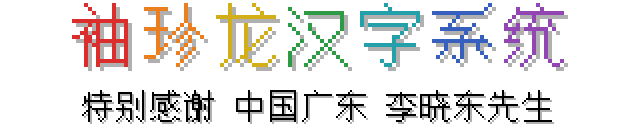
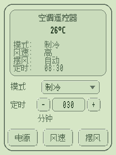
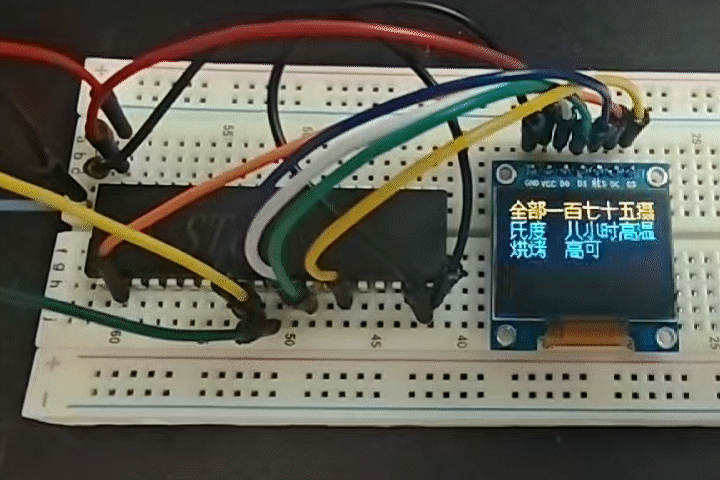
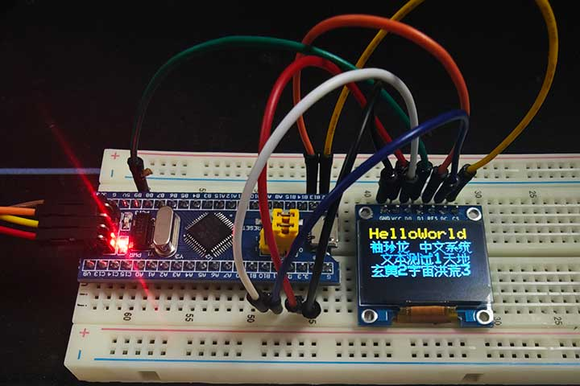
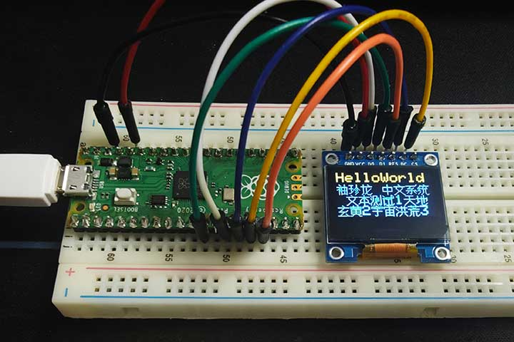

# Lvgl_XZL_Chinese_Font

English | [简体中文](README_zh.md)



## Overview

An exceptionally compact Simplified Chinese font solution for resource-constrained devices, covering all 6,763 Chinese characters in GB2312. The font data occupies 29,903 bytes. On tested platforms, the complete font module, including data and decoder code, can use less than 40 KB of Flash. It is suitable for applications with limited storage whose display text cannot be determined in advance.

The font data and rendering logic originate from **Xiuzhenlong Chinese System (XZL) 2.0**, released in 1994. The original system could display all 6,763 Chinese characters while using no more than 80 KB of resident memory—an impressive technical achievement. This project ports its character construction and rendering logic to C, reorganizes the Unicode index, and provides both an LVGL font interface and a standalone bitmap interface.

The current output is a 16×16, 1 bpp Chinese character bitmap. The project includes Keil C51, Keil C251, and Arduino OLED examples. Macros allow the memory spaces of read-only data, working variables, and pointers to be configured for different platforms and memory models.

### How It Works

The font does not store a complete bitmap for each character. Instead, it describes glyphs using shared components and strokes. Shared components are stored as a directed acyclic graph and expanded into a component tree during decoding. Glyph composition is described by 24 layout operations: 19 basic layout operations and 5 special combinations. These control the positioning and scaling of components in left–right, top–bottom, partial inset, and repeated-component arrangements.

This port groups characters in Unicode order into 106 pages of up to 64 characters each. The page directory stores 16-bit first code points and data offsets. Within each page, code-point differences are Elias-gamma encoded. Characters are located through a binary search of the page directory followed by decoding the differences within the selected page. A 7-entry Move-to-Front (MTF) table compresses component references in character root descriptors, further reducing the size of the index and descriptor data.

Leaf nodes in the component tree reference basic strokes. Each line segment uses two bytes to encode its start and end points, with 4 bits each for the x and y coordinates of each endpoint. After geometric transformation, the renderer draws single-pixel line segments along directions spaced at 45-degree intervals, producing a 32-byte, 16×16, 1 bpp bitmap.

## Character Coverage

The font contains only the **6,763 Chinese characters** in GB2312. It does not include ASCII characters, full-width punctuation, arrows, circled numbers, or other symbols, nor does it cover all Unicode Chinese characters.

For mixed text in LVGL, configure a **fallback font** that covers the additional characters you need. For standalone use, the application should check the decoder's return value and render unsupported characters using another font. The Arduino example uses Adafruit GFX's default font for ASCII characters.

## Memory Footprint

The following figures were compiled from the build results and linker map files of tested examples to illustrate actual memory usage. Sizes are in bytes (B), with **1 KiB = 1,024 B**. Whole-program usage includes display drivers, runtime libraries, and example logic. Font-module usage primarily includes font data, decoder code, and font descriptors.

| Microcontroller / Operating Mode | Example | Main Compiler Settings | Whole-Program Flash | RAM | Font-Module Flash | Font Data Included |
| --- | --- | --- | ---: | --- | --- | ---: |
| STC8051U-34K64, 51 mode | `Keil_C51_OLED_SSD1306`, OLED SPI-DMA | Keil C51; LARGE data model; LARGE ROM model; optimization level 9; ANSI integer promotion enabled | 41,669 B (40.69 KiB) | DATA: 9 B + 2 bits; XDATA: 1,428 B | 38,398 B (37.50 KiB) | 29,903 B |
| STC8051U-34K64, 251 mode | `Keil_C251_OLED_SSD1306`, OLED SPI-DMA | Keil C251 V5.60.0; 251 SOURCE MODE; XSMALL data model; LARGE ROM model; optimization level 9 | 37,576 B (36.70 KiB) | DATA: 8 B + 2 bits; EDATA + HDATA: 1,024 B; XDATA: 1,029 B | 35,598 B (34.76 KiB) | 29,903 B |
| STM32F103C8, Blue Pill | `Adafruit_SSD1306_XZL_test`, software SPI | Arduino; ARM GCC 14.2.1; `-Os`, LTO | 59,928 B (58.52 KiB) | `.data`: 224 B; `.bss`: 1,476 B; total: 1,700 B | LTO merges source modules, so the available map file cannot isolate the font module precisely | 29,903 B |
| RP2040, Raspberry Pi Pico | `Adafruit_SSD1306_XZL_test`, software SPI | Arduino-Pico 5.7.0; ARM GCC 14.3.0; `-Os` | 120,052 B (117.24 KiB) | `.data`: 4,908 B; `.bss`: 4,588 B; total: 9,496 B | 34,169 B (33.37 KiB) | 29,903 B |

Measurement scope:

- **Font data** is the combined payload of the 15 arrays in `xzl_data.h`, including the Unicode index, compressed records, component nodes, and stroke data. It excludes decoder code and platform alignment padding.
- **Font-module Flash** excludes UTF-8 decoding, OLED bitmap transposition, and display drivers in the examples. Shared runtime libraries are not apportioned to the module, so this figure is not the exact difference in whole-program size before and after removing the font.
- **RAM** figures come from linker statistics and should not be treated as the font's independent RAM usage or peak runtime usage. Keil may overlay local variables. The ARM figures exclude heap and stack reservations and runtime dynamic allocations.
- **Compiler settings** were compiled from project configurations and map files. Complete compiler commands were not supplied for the two Arduino builds; their optimization settings were inferred from the map filenames. Usage may change with different toolchains, configurations, or code.

## Usage

### Files

| File | Purpose |
| --- | --- |
| `lv_font_xzl_16.c` | Glyph decoding, stroke rendering, and LVGL font interface |
| `lv_font_xzl_16.h` | Declarations for the font object and standalone bitmap interface |
| `lv_font_xzl_16_config.h` | Platform, data type, memory-space, and calling-convention configuration |
| `xzl_data.h` | Font data, included by the implementation file |
| `lvgl_minimal.h` | Minimal type and interface definitions for standalone use |
| `tests/` | Arduino, Keil C51, and Keil C251 examples |

### Using the Font in an LVGL Project

The current font adapter targets the **LVGL 9.5.x** interface. Add the font files listed above to your project and include `lv_font_xzl_16.c` in the build. Define `USE_LVGL_MINIMAL=0` consistently across the project, or change its default value to `0` in `lv_font_xzl_16_config.h`, to use the full LVGL headers.

The following example configures an ASCII fallback font and applies the Chinese font to a label:

```c
#include "lv_font_xzl_16.h"

/* Keep the font object alive for subsequent LVGL rendering. */
static lv_font_t chinese_font;

void create_chinese_label(lv_obj_t *parent)
{
    lv_obj_t *label;

    chinese_font = lv_font_xzl_16;
    chinese_font.fallback = &lv_font_montserrat_16;

    label = lv_label_create(parent);
    lv_obj_set_style_text_font(label, &chinese_font, 0);
    lv_label_set_text(label, "你好世界 Hello World!");
}
```

Enable `LV_FONT_MONTSERRAT_16` in the LVGL configuration to use this example. That font only supplies characters it already covers. If you need full-width punctuation or other symbols, choose a fallback font that contains them. The text encoding must also match the LVGL configuration; UTF-8 is typically used.

### Obtaining Bitmaps Without LVGL

For standalone use, keep the default setting `USE_LVGL_MINIMAL=1`; the full LVGL library is not required. Include `lv_font_xzl_16.c` in the build and call the interface already declared in the header:

```c
LV_FONT_XZL_BOOL xzl_unicode_to_bitmap(
    LV_FONT_XZL_UINT32 cp,
    LV_FONT_XZL_WORK_PTR(LV_FONT_XZL_UINT8) buf
) LV_FONT_XZL_REENTRANT;
```

- `cp`: The Unicode code point of a single character, not a UTF-8 byte sequence or a two-byte GB2312 code.
- `buf`: A writable buffer of at least 32 bytes. Its memory space must match the pointer type used by the interface.
- Return value: Nonzero on success; zero if the code point is unsupported or the buffer pointer is null. Do not use the buffer contents as a valid glyph after a failed call.

Example:

```c
#include "lv_font_xzl_16.h"

static LV_FONT_XZL_UINT8 LV_FONT_XZL_WORKDATA bitmap[32];

void render_example(void)
{
    if (xzl_unicode_to_bitmap(0x4F60u, bitmap)) { /* 你 (U+4F60) */
        /* Pass bitmap to the display driver, or copy it to the framebuffer. */
    }
}
```

The output is **row-major, top to bottom, two bytes per row, with the most significant bit representing the leftmost pixel**. For pixel `(x, y)`, the byte index is `y * 2 + (x >> 3)` and the bit mask is `0x80u >> (x & 7)`. Both `x` and `y` range from `0` to `15`; a bit value of `1` indicates a stroke pixel.

With Arduino / Adafruit GFX, pass the successfully decoded RAM buffer directly to `drawBitmap()`:

```cpp
uint8_t bitmap[32];

if (xzl_unicode_to_bitmap(0x4F60u, bitmap)) {
    display.drawBitmap(0, 0, bitmap, 16, 16, SSD1306_WHITE);
    display.display();
}
```

When writing directly to SSD1306 page-organized display RAM, first convert the row-major bitmap to the vertical page format. With Adafruit GFX's `drawBitmap()`, the graphics library handles pixel writes. To process a UTF-8 string, the application must first decode its byte sequence into Unicode code points; see the included Arduino example.

### Platform Configuration and Examples

`lv_font_xzl_16_config.h` detects Keil C51, Keil C251, SDCC MCS-51, AVR, or a generic platform using compiler macros. A platform can also be selected manually through the `LV_FONT_XZL_PLATFORM_*` macros. Working objects default to `xdata` on Keil C51 and `near` on Keil C251. When customizing memory spaces, adjust both the object qualifiers and the corresponding pointer qualifiers.

`LV_FONT_XZL_USE_REENTRANT` is disabled by default. If you enable it on a relevant compiler, also check function-pointer calling conventions and stack capacity. Callback types in the full LVGL library must remain compatible with the actual functions.

| Example Directory | Description |
| --- | --- |
| `tests/Adafruit_SSD1306_XZL_test/` | Arduino, Adafruit GFX, and SSD1306; includes UTF-8 text handling and Chinese character rendering |
| `tests/Keil_C51_OLED_SSD1306/` | OLED SPI-DMA example for STC8051U in 51 mode |
| `tests/Keil_C251_OLED_SSD1306/` | OLED SPI-DMA example for STC8051U in 251 mode |

To use the Arduino example, copy the font `.c` and `.h` files from the project root into the sketch directory and install the Adafruit GFX and Adafruit SSD1306 libraries. Adjust pin assignments and hardware settings in each example for your device.

## TODO

- [ ] Support additional rendering sizes, such as 12, 18, and 24 pixels.
- [ ] Support alternative bitmap layouts, including direct output in OLED page format to reduce the need for transposition.
- [ ] Integrate with graphics libraries such as U8g2.
- [ ] Add low-cost antialiasing.
- [ ] Develop a companion glyph-construction tool to extend coverage to 20,902 characters or larger character sets, and support on-demand subsetting.
- [ ] Provide an optional rendering mode that connects endpoints directly, exploring finer and softer glyph styles using the existing stroke data.

The image below shows an experiment rendering the four characters “孤独摇滚” (“Bocchi the Rock!”) by replacing eight-direction segment combinations with direct lines between endpoints. The original eight-direction drawing logic remains the default.


## Original Copyright Information

The original Xiuzhenlong system's copyright and author information is preserved below, verbatim:

```text
袖珍龙(C) 中文系统  版本 2.0

(C) 广东兴宁 李晓东  1994-12-28

世界上最小的汉字系统—— [袖珍龙] 中文系统

  版权所有：兰花指软件工作室

  作者：李晓东

  电子信箱：f22@126.com

  个人主页：http://xd.126.com
```

## Gallery

### LVGL Interface Demo



### STC8051U OLED Demo



### STM32F103C8 (Blue Pill)



### RP2040 (Raspberry Pi Pico)



## AI Assistance Disclosure

This project used ChatGPT 5.6 Sol to assist with analyzing memory dumps from a DOS environment, disassembling the relevant program, and reconstructing its character construction and rendering logic as equivalent C code. The original GB2312-ordered character entries were then reorganized into Unicode order, and memory-space configuration macros were added for platforms such as C51, C251, and AVR. ChatGPT 6 Luna was used to assist with revising and translating the documentation.
