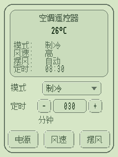
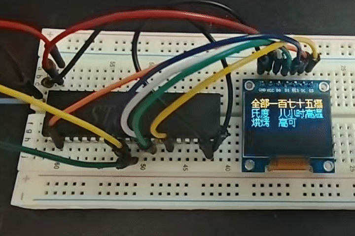
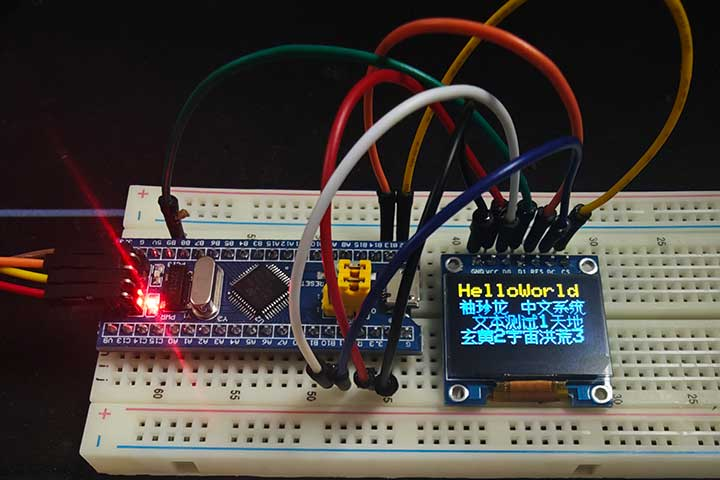
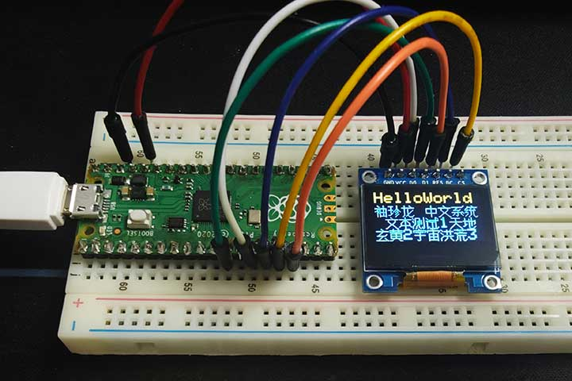

# Lvgl_XZL_Chinese_Font

[English](README.md) | 简体中文


## 项目简介

一个面向资源受限设备的超小体积简体中文字库方案，可显示 GB2312 收录的全部 6,763 个汉字。字库数据占用 29,903 字节；在已测试的平台上，包含数据与解码代码的字库模块 Flash 占用可低于 40 KB，适合存储空间紧张、显示内容无法预先确定的应用。

字库数据与渲染逻辑源自 1994 年发布的 袖珍龙汉字系统（XZL）2.0。原系统在常驻内存不超过 80 KB 的条件下，实现了全部 6,763 个汉字的显示，可谓技术奇迹。本项目将其构字与渲染逻辑移植为 C 代码，重新组织 Unicode 索引，并提供 LVGL 字体接口及可独立调用的点阵接口。

当前输出为 16×16 1bpp 汉字点阵。项目提供 Keil C51、Keil C251 和 Arduino OLED 示例，并允许通过宏配置只读数据、工作变量及指针的存储空间，以适配不同平台和存储模型。

### 工作原理

字库不存储每个汉字的完整点阵，而以共享构件和笔画描述字形。共享构件以有向无环图存储，解码时按引用关系展开为构件树。构型由 24 种布局操作描述，包括 19 种基础布局操作与 5 种特殊组合，用于控制左右、上下、局部嵌入及重复构件的定位与缩放。

本移植按 Unicode 顺序将汉字划分为每页 64 字，共 106 页。页目录保存 16 位首码点与数据偏移，页内码点差值采用 Elias-γ 编码，通过页间二分查找和页内差分解码定位字符。字符的根描述使用 7 项移至前端（Move-to-Front，MTF）表压缩构件引用，进一步减少索引与描述数据的占用。

构件树的叶节点引用基本笔画。每条线段以两字节记录起止端点，每个端点的横、纵坐标各占 4 位。经过几何变换后，渲染器按 45 度方向绘制单线段，最终得到 32 字节的 16×16 1bpp 点阵。

## 收录范围

字库仅包含 GB2312 标准中的 **6,763 个汉字**，不包含 ASCII 字符、全角标点、箭头、带圈数字等其他字符，也不覆盖全部 Unicode 汉字。

在 LVGL 中显示混合文本时，应设置覆盖所需字符的 **fallback 字体**。在独立使用时，应由应用判断解码结果，并使用其他字体绘制未收录的字符。Arduino 示例使用 Adafruit GFX 的默认字体处理 ASCII 字符。

## 空间占用

以下数据依据已测试示例的构建结果及链接映射文件整理，用于展示实际占用量级。容量单位为字节（B），**1 KiB = 1,024 B**。整程序占用包含显示驱动、运行库和示例逻辑；字库模块占用主要包含字库数据、解码代码及字体描述信息。

| 单片机／运行模式 | 对应示例 | 主要编译参数 | 整程序 Flash | RAM | 字库模块 Flash | 其中字库数据 |
| --- | --- | --- | ---: | --- | --- | ---: |
| STC8051U-34K64，51 模式 | `Keil_C51_OLED_SSD1306`，OLED SPI-DMA | Keil C51；数据模型 LARGE；ROM LARGE；优化等级 9；开启 ANSI 整数提升 | 41,669 B（40.69 KiB） | DATA：9 B + 2 bit；XDATA：1,428 B | 38,398 B（37.50 KiB） | 29,903 B |
| STC8051U-34K64，251 模式 | `Keil_C251_OLED_SSD1306`，OLED SPI-DMA | Keil C251 V5.60.0；251 SOURCE MODE；数据模型 XSMALL；ROM LARGE；优化等级 9 | 37,576 B（36.70 KiB） | DATA：8 B + 2 bit；EDATA + HDATA：1,024 B；XDATA：1,029 B | 35,598 B（34.76 KiB） | 29,903 B |
| STM32F103C8，Blue Pill | `Adafruit_SSD1306_XZL_test`，软件 SPI | Arduino；ARM GCC 14.2.1；`-Os`、LTO | 59,928 B（58.52 KiB） | `.data`：224 B；`.bss`：1,476 B；合计 1,700 B | LTO 合并了源文件，现有映射文件无法精确拆分 | 29,903 B |
| RP2040，Raspberry Pi Pico | `Adafruit_SSD1306_XZL_test`，软件 SPI | Arduino-Pico 5.7.0；ARM GCC 14.3.0；`-Os` | 120,052 B（117.24 KiB） | `.data`：4,908 B；`.bss`：4,588 B；合计 9,496 B | 34,169 B（33.37 KiB） | 29,903 B |

统计口径：

- **字库数据**为 `xzl_data.h` 中 15 个数组的有效载荷总和，包含 Unicode 索引、压缩记录、构件节点和笔画数据，不包含解码代码或平台对齐填充。
- **字库模块 Flash**不包含示例中的 UTF-8 解码、OLED 点阵转置和显示驱动，也不分摊公共运行库，因此不等同于移除字库前后的整程序差值。
- **RAM**为链接统计，不能直接视为字库的独立 RAM 占用或运行时峰值。Keil 存在局部变量重叠分配；ARM 表中未计入堆、栈预留及运行时动态分配。
- **编译参数**依据工程配置及映射文件整理；两份 Arduino 构建未附完整编译命令，优化选项依据映射文件名。改变工具链、配置或代码后，占用可能变化。

## 如何使用

### 文件说明

| 文件 | 用途 |
| --- | --- |
| `lv_font_xzl_16.c` | 字形解码、笔画绘制及 LVGL 字体接口 |
| `lv_font_xzl_16.h` | 字体对象与独立点阵接口的声明 |
| `lv_font_xzl_16_config.h` | 平台、数据类型、存储空间及调用约定配置 |
| `xzl_data.h` | 字库数据，由实现文件包含 |
| `lvgl_minimal.h` | 独立使用时所需的最小类型与接口定义 |
| `tests/` | Arduino、Keil C51 与 Keil C251 示例 |

### 在 LVGL 工程中使用

当前字体适配代码面向 **LVGL 9.5.x** 接口。将上述字库文件放入工程，并将 `lv_font_xzl_16.c` 纳入编译。在工程中统一定义 `USE_LVGL_MINIMAL=0`，或将 `lv_font_xzl_16_config.h` 中该宏的默认值改为 `0`，以使用完整 LVGL 头文件。

以下示例为汉字字体配置 ASCII fallback，并将其应用到标签：

```c
#include "lv_font_xzl_16.h"

/* 保持字体对象有效，供 LVGL 后续绘制使用。 */
static lv_font_t chinese_font;

void create_chinese_label(lv_obj_t *parent)
{
    lv_obj_t *label;

    chinese_font = lv_font_xzl_16;
    chinese_font.fallback = &lv_font_montserrat_16;

    label = lv_label_create(parent);
    lv_obj_set_style_text_font(label, &chinese_font, 0);
    lv_label_set_text(label, "你好世界 Hello World!");
}
```

使用此示例需在 LVGL 配置中启用 `LV_FONT_MONTSERRAT_16`。该字体仅用于补充其已覆盖的字符；若需要全角标点或其他符号，应改用包含这些字符的 fallback 字体。文本编码也应与 LVGL 的配置一致，通常使用 UTF-8。

### 脱离 LVGL，直接取得点阵

独立使用时，保留默认配置 `USE_LVGL_MINIMAL=1` 即可，无需引入完整 LVGL。将 `lv_font_xzl_16.c` 纳入编译，并调用头文件中已声明的接口：

```c
LV_FONT_XZL_BOOL xzl_unicode_to_bitmap(
    LV_FONT_XZL_UINT32 cp,
    LV_FONT_XZL_WORK_PTR(LV_FONT_XZL_UINT8) buf
) LV_FONT_XZL_REENTRANT;
```

- `cp`：单个字符的 Unicode 码点，不是 UTF-8 字节序列或 GB2312 双字节编码。
- `buf`：至少 32 字节的可写缓冲区，其存储空间应与接口的指针类型一致。
- 返回值：成功返回非零；码点未收录或缓冲区为空时返回零。失败时不应使用缓冲区内容作为有效字模。

示例：

```c
#include "lv_font_xzl_16.h"

static LV_FONT_XZL_UINT8 LV_FONT_XZL_WORKDATA bitmap[32];

void render_example(void)
{
    if (xzl_unicode_to_bitmap(0x4F60u, bitmap)) { /* 你 */
        /* 将 bitmap 交给显示驱动，或复制到屏幕缓冲区。 */
    }
}
```

输出格式为 **逐行扫描、从上到下、每行两字节、最高位对应最左像素**。像素 `(x, y)` 的字节下标为 `y * 2 + (x >> 3)`，位掩码为 `0x80u >> (x & 7)`；其中 `x`、`y` 的范围均为 `0` 至 `15`，位值 `1` 表示笔画像素。

在 Arduino／Adafruit GFX 中，可将成功解码的 RAM 缓冲区直接交给 `drawBitmap()`：

```cpp
uint8_t bitmap[32];

if (xzl_unicode_to_bitmap(0x4F60u, bitmap)) {
    display.drawBitmap(0, 0, bitmap, 16, 16, SSD1306_WHITE);
    display.display();
}
```

直接写入 SSD1306 的页式显存时，需先将行式点阵转换为纵向页格式；使用 Adafruit GFX 的 `drawBitmap()` 则由图形库完成像素写入。处理 UTF-8 字符串时，应用还需先将字节序列解码为 Unicode 码点，可参考所附 Arduino 示例。

### 平台配置与示例

`lv_font_xzl_16_config.h` 会根据编译器宏识别 Keil C51、Keil C251、SDCC MCS-51、AVR 或通用平台，也可通过 `LV_FONT_XZL_PLATFORM_*` 宏手动选择。Keil C51 默认将工作对象放入 `xdata`，Keil C251 默认使用 `near`；自定义存储空间时，应同时调整对象与对应指针的空间限定。

`LV_FONT_XZL_USE_REENTRANT` 默认关闭。如需在相应编译器上开启，应同步检查函数指针的调用约定及栈空间；完整 LVGL 的回调类型也必须与实际函数保持兼容。

| 示例目录 | 说明 |
| --- | --- |
| `tests/Adafruit_SSD1306_XZL_test/` | Arduino、Adafruit GFX 与 SSD1306；包含 UTF-8 文本处理及汉字绘制示例 |
| `tests/Keil_C51_OLED_SSD1306/` | STC8051U 的 51 模式 OLED SPI-DMA 示例 |
| `tests/Keil_C251_OLED_SSD1306/` | STC8051U 的 251 模式 OLED SPI-DMA 示例 |

使用 Arduino 示例时，将根目录的字库 `.c`、`.h` 文件复制到 sketch 目录，并安装 Adafruit GFX 和 Adafruit SSD1306 库。各示例的引脚与硬件配置请按实际设备调整。

## 待办事项

- [ ] 支持更多渲染尺寸，如 12、18、24 像素。
- [ ] 支持不同取模策略，直接输出适合 OLED 页式显存的点阵，减少二次转置。
- [ ] 对接 U8g2 等图形库。
- [ ] 增加低成本抗锯齿渲染。
- [ ] 设计配套构字工具，将字库扩展至 20,902 字或更大的字符集，并支持按需裁剪。
- [ ] 提供两端点直接连线的可选渲染模式，利用现有笔画数据探索更纤细、柔和的字形风格。

下图为将八向线段组合替换为两端点直线后，“孤独摇滚”四字的实验效果；当前默认渲染方式仍为原有八向划线逻辑。


## 原始著作权信息

以下保留原始袖珍龙系统的著作权与作者信息：

```text
袖珍龙(C) 中文系统  版本 2.0

(C) 广东兴宁 李晓东  1994-12-28

世界上最小的汉字系统—— [袖珍龙] 中文系统

  版权所有：兰花指软件工作室

  作者：李晓东

  电子信箱：f22@126.com

  个人主页：http://xd.126.com
```

## 相册

### LVGL 界面演示



### STC8051U OLED 显示演示



### STM32F103C8（Blue Pill）



### RP2040（Raspberry Pi Pico）



## AI 辅助声明

本项目使用 ChatGPT 5.6 Sol 辅助分析 DOS 环境下的内存转储，对相关程序进行反汇编，并将构字与渲染逻辑重构为等效 C 代码。在此基础上，将原始 GB2312 顺序的字符入口重新组织为 Unicode 顺序，并加入面向 C51、C251、AVR 等平台的存储空间配置宏。使用 ChatGPT 6 Luna 辅助修订和翻译文档。
